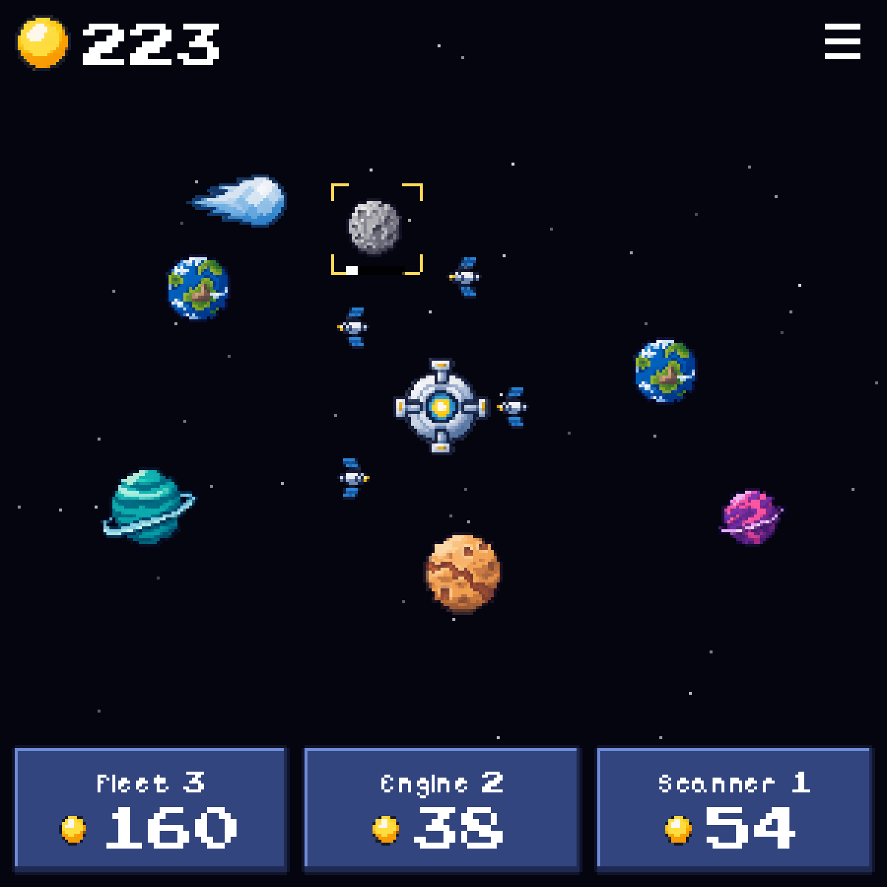
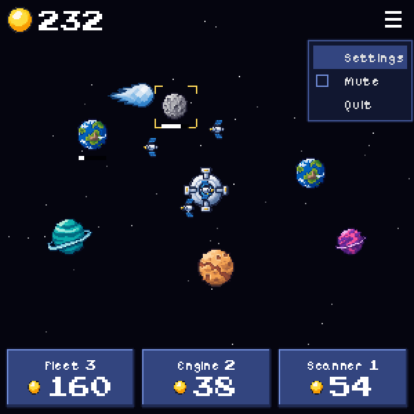
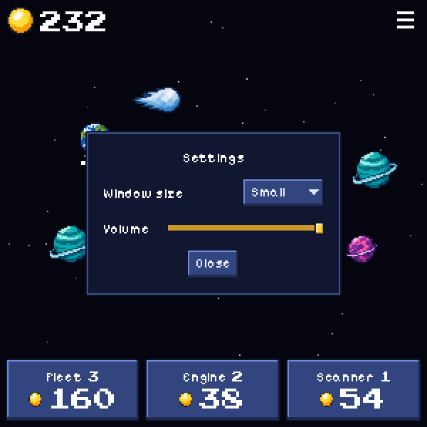

# Driftlight

A tiny idle game that lives in the corner of your screen. Your probes fly out into the dark on their own, scan planets
and carry light home while you get on with something else. Spend the light on more probes, faster engines and better
scanners, and lend a hand yourself whenever you feel like it.

**Developed by FDRK Group.** Driftlight is in early alpha: new versions come out often, and things will change.

  

## Download and play

Go to the [Releases](../../releases) page and download the newest zip for your computer.

**Windows**

1. Unzip it anywhere and double-click **Driftlight.exe**.
2. The game isn't signed by a known publisher yet, so Windows may say it protected your PC: click **More info**, then
   **Run anyway**.

**Mac**

1. Unzip it and move **Driftlight** into your Applications folder, then open it.
2. The game isn't signed by a known developer yet, so macOS refuses the first time. Open **System Settings**, go to
   **Privacy & Security**, scroll down and click **Open Anyway**. On older versions of macOS, right-click the game and
   choose **Open** instead.

Only run builds downloaded from this repository's Releases page.

**Needs:** Windows 10 or 11, 64-bit, or a Mac with an Intel or Apple chip.

## How to play

The game plays itself. Everything below is optional.

| You do | What happens |
|---|---|
| Nothing | Probes pick a planet, scan it and bring its light home, over and over |
| Click a planet | It gets gold brackets: the next free probe goes there first and scans it twice as fast |
| Click a comet | You catch it for a burst of light. One flies past every minute or two |
| Click an upgrade | **Fleet** launches one more probe, **Engine** makes probes faster, **Scanner** brings more light from every scan |
| Drag an empty spot | Moves the window |
| Click the three bars | Opens the menu: Settings, Mute and Quit |

The window stays on top of your other windows, and the game saves on its own. Settings let you change the window size
and the volume.

## More screenshots

| Menu | Settings |
|---|---|
|  |  |

## Versions

Every version is on the [Releases](../../releases) page, and [CHANGELOG.md](CHANGELOG.md) lists what changed in each one.

## Feedback

If you hit a bug or have an idea, [open an issue](../../issues).

## License

All rights reserved, © 2026 Donát Fodor. The game and its art may not be copied, reused or redistributed without
permission.

The game uses the Pixelify Sans and Press Start 2P fonts, under the SIL Open Font License, and is built with the Godot
Engine, under the MIT License. Their licence files are in [licenses](licenses).
