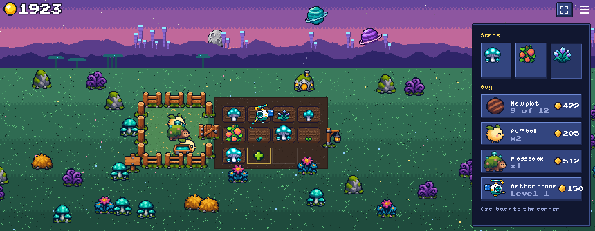
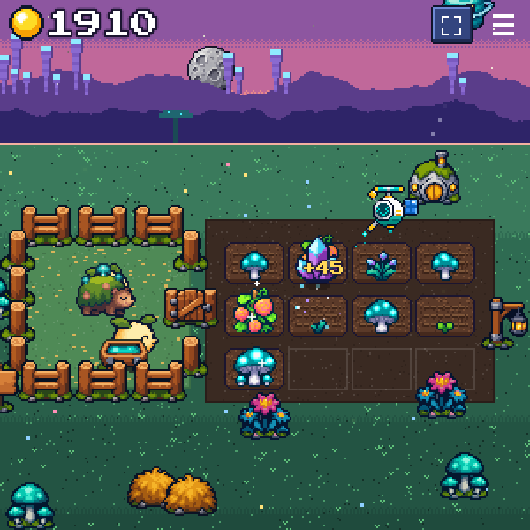
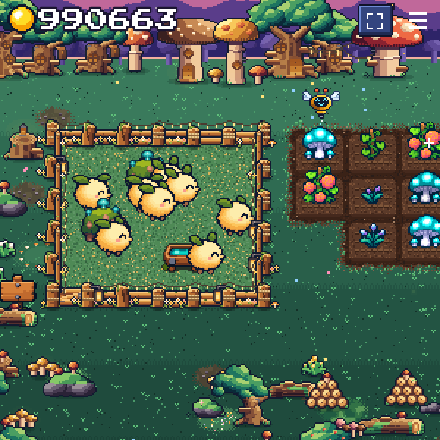
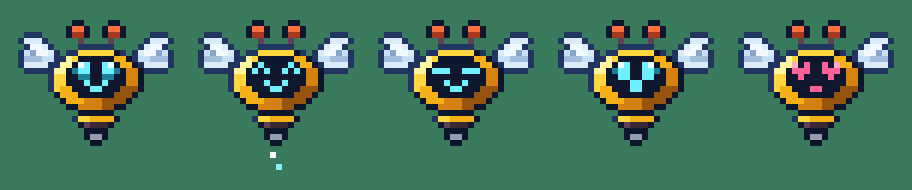

# Driftlight

A tiny farm on a faraway planet that lives in the corner of your screen. Alien crops glow, strange animals wander their
pen, and a little helper drone looks after everything while you get on with something else. Open the farm to the whole
screen whenever you want to tend it yourself.

**Developed by FDRK Group.** Driftlight is in early alpha: new versions come out often, and things will change.

## What it looks like

The full view, with the shop on the right:

The corner view, the small window that sits on your screen and plays itself:

The pen can grow. **Bigger pen** in the shop adds one bay of fence, to the left or down, up to 6 by 6 bays, with room for more animals:

The helper drone has moods: happy when it is idle, squinting while it works, a blink now and then, wow when you upgrade
it, and hearts after it finishes a job.

## Download and play

Driftlight is for **Windows** for now. Go to the [Releases](../../releases) page and download the newest zip.

1. Unzip it anywhere and double-click **Driftlight.exe**.
2. Windows may say it protected your PC. That is normal for this game for now, see below: click **More info**, then
   **Run anyway**.
3. On a very sharp screen the small corner window can look tiny. Open the menu (the three bars), choose **Settings**, and
   pick a bigger **Corner size**.

**Needs:** Windows 10 or 11, 64-bit.

### Why does Windows show a warning?

The first time, Windows shows a blue screen: "Windows protected your PC", with "Unknown publisher". It does that for every
program that is not signed with a code-signing certificate and that not many people have run yet. Driftlight is not signed
yet (the certificates cost money every year), so Windows has never heard of it. It does not mean the game was found to be
harmful.

To be careful:

- Only download Driftlight from this repository's [Releases](../../releases) page.
- Each release lists a SHA-256 checksum for its zip. In PowerShell, run `Get-FileHash .\Driftlight-v0.0.6-Windows.zip`
  (with the file name you downloaded) and check that the long code is the same as the one on the release page.
- If you would rather not run it, close the blue screen: nothing has been started.

There is no Mac version at the moment.

## How to play

The farm plays itself. Everything below is optional.

| You do | What happens |
|---|---|
| Nothing | The helper drone harvests ripe crops, replants them, plants empty plots and collects goods from the animals, one job at a time. It brings in about 70% of what a click would |
| Click a ripe crop | You harvest it at once, for the full value. It replants itself |
| Click the bubble above an animal | You collect its goods at once, for the full value |
| Click the open button, top right | The farm opens up to the whole screen, with a shop on the right. Press **Esc** to go back to the corner |
| In the full view | Pick a seed to plant, unlock new seeds, buy animals for the pen, a bigger pen and a better drone. **New plot** lets you click where the plot goes |
| Scroll, use the arrow keys, or drag with the right mouse button | Moves the view over the land. In the full view, dragging empty ground does it too. In the corner, small arrows at the window's edges do the same |
| Drag an empty spot in the corner | Moves the window |
| Close the game | The farm keeps growing for up to 8 hours. When you open the game again, a "Welcome back" panel says how much light it brought |

The game saves on its own. Settings change the size of the corner window and the volume, and let you turn off the growing
animation if the full view should just fade in.

## The planet: Mossrill

| Crop | Grows in | Worth |
|---|---|---|
| Glowcap, a glowing mushroom | 45 seconds | 6 light |
| Spiralvine, a curly vine with striped fruit | 100 seconds | 18 light |
| Prismfern, a fern with crystal fronds | 210 seconds | 45 light |

| Animal | Makes goods every | Worth |
|---|---|---|
| Puffball, a floating fluffy creature | 50 seconds | 10 light |
| Mossback, a mossy shelled walker | 120 seconds | 30 light |

## Versions

Every version is on the [Releases](../../releases) page, and [CHANGELOG.md](CHANGELOG.md) lists what changed in each one.

## Feedback

If you hit a bug or have an idea, [open an issue](../../issues). The numbers (how fast crops grow, what things cost) are
first guesses, so tell us how the pace feels.

## License

All rights reserved, © 2026 Donát Fodor. The game and its art may not be copied, reused or redistributed without
permission.

The game uses the Pixelify Sans and Press Start 2P fonts, under the SIL Open Font License, and is built with the Godot
Engine, under the MIT License. Their licence files are in [licenses](licenses).
