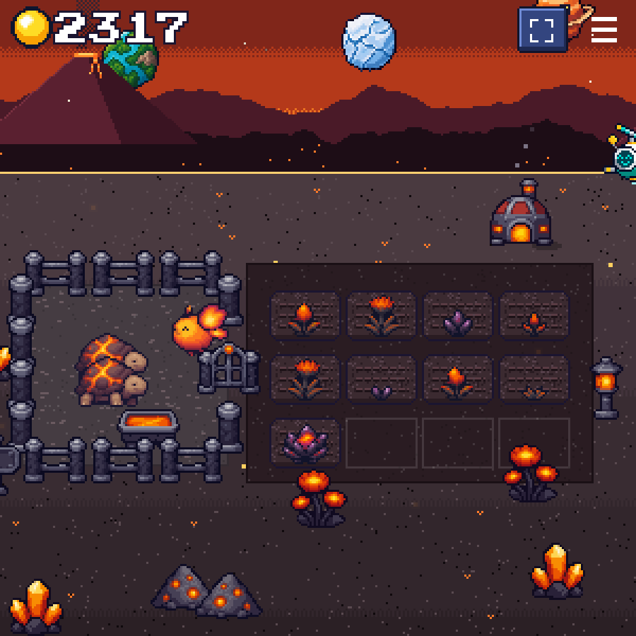

# Driftlight

A tiny farm on a faraway planet that lives in the corner of your screen. Alien crops glow, strange animals wander their
pen, and a little helper drone looks after everything while you get on with something else. Open the farm to the whole
screen whenever you want to tend it yourself.

**Developed by FDRK Group.** Driftlight is in early alpha: new versions come out often, and things will change.

## What it looks like

The full view, with the shop on the right:

The corner view, the small window that sits on your screen and plays itself:

The helper drone has moods: happy when it is idle, squinting while it works, a blink now and then, wow when you upgrade
it, and hearts after it finishes a job.

## Download and play

Go to the [Releases](../../releases) page and download the newest zip for your computer.

**Windows**

1. Unzip it anywhere and double-click **Driftlight.exe**.
2. The game isn't signed by a known publisher yet, so Windows may say it protected your PC: click **More info**, then
   **Run anyway**.
3. On a very sharp screen the small corner window can look tiny. Open the menu (the three bars), choose **Settings**, and
   pick a bigger **Corner size**.

**Mac**

1. Unzip it and move **Driftlight** into your Applications folder, then open it.
2. The game isn't signed by a known developer yet, so macOS refuses the first time. Open **System Settings**, go to
   **Privacy & Security**, scroll down and click **Open Anyway**. On older versions of macOS, right-click the game and
   choose **Open** instead.

Only run builds downloaded from this repository's Releases page.

**Needs:** Windows 10 or 11, 64-bit, or a Mac with an Intel or Apple chip.

## How to play

The farm plays itself. Everything below is optional.

| You do | What happens |
|---|---|
| Nothing | The helper drone harvests ripe crops, replants them, plants empty plots and collects goods from the animals, one job at a time. It brings in about 70% of what a click would |
| Click a ripe crop | You harvest it at once, for the full value. It replants itself |
| Click the bubble above an animal | You collect its goods at once, for the full value |
| Click the open button, top right | The farm opens up to the whole screen, with a shop on the right. Press **Esc** to go back to the corner |
| In the full view, click the planet's name, top right | The **Planets** panel: settle a new planet once for its price in light, or travel to one you have. Each planet has its own field, pen and drone, and all of them keep running |
| In the full view | Pick a seed to plant, unlock new seeds, buy plots for the field, animals for the pen, and a better drone. The gold **+** in the field is the next plot |
| Drag an empty spot in the corner | Moves the window |
| Close the game | The farm keeps growing for up to 8 hours. When you open the game again, a "Welcome back" panel says how much light it brought |

The game saves on its own. Settings change the size of the corner window and the volume, and let you turn off the growing
animation if the full view should just fade in.

## The first planet: Mossrill

| Crop | Grows in | Worth |
|---|---|---|
| Glowcap, a glowing mushroom | 45 seconds | 6 light |
| Spiralvine, a curly vine with striped fruit | 100 seconds | 18 light |
| Prismfern, a fern with crystal fronds | 210 seconds | 45 light |

| Animal | Makes goods every | Worth |
|---|---|---|
| Puffball, a floating fluffy creature | 50 seconds | 10 light |
| Mossback, a mossy shelled walker | 120 seconds | 30 light |

## The second planet: Cinderrift

A lava world, settled once for 1500 light from the Planets panel in the full view.

| Crop | Grows in | Worth |
|---|---|---|
| Emberbulb, a glowing orange bulb | 60 seconds | 30 light |
| Cinderthistle, a charcoal thistle with a flame bloom | 130 seconds | 85 light |
| Obsidian Lotus, a glossy black lotus with a magma core | 270 seconds | 220 light |

| Animal | Makes goods every | Worth |
|---|---|---|
| Embermoth, a floating moth made of embers | 70 seconds | 40 light |
| Slagback, a rocky walker with a lava-cracked shell | 140 seconds | 100 light |

## Versions

Every version is on the [Releases](../../releases) page, and [CHANGELOG.md](CHANGELOG.md) lists what changed in each one.

## Feedback

If you hit a bug or have an idea, [open an issue](../../issues). The numbers (how fast crops grow, what things cost) are
first guesses, so tell us how the pace feels.

## License

All rights reserved, © 2026 Donát Fodor. The game and its art may not be copied, reused or redistributed without
permission.

The game uses the Pixelify Sans and Press Start 2P fonts, under the SIL Open Font License, and is built with the Godot
Engine, under the MIT License. Their licence files are in [licenses](licenses).
